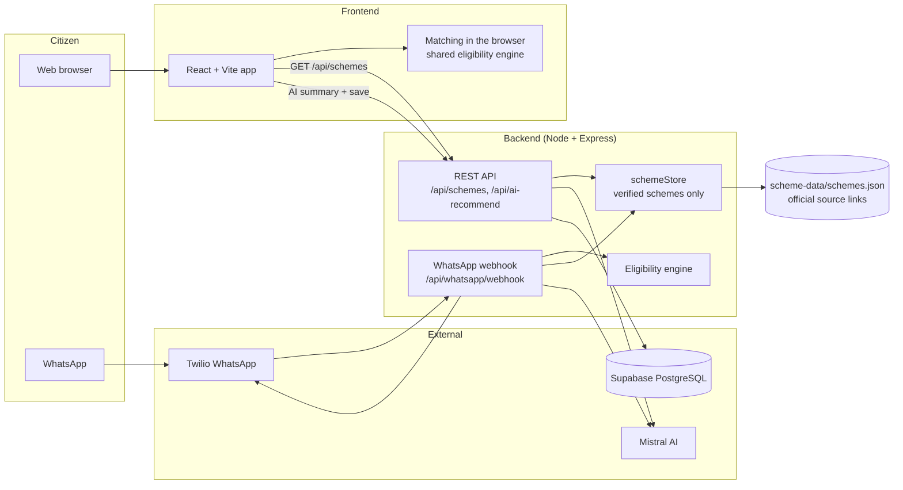
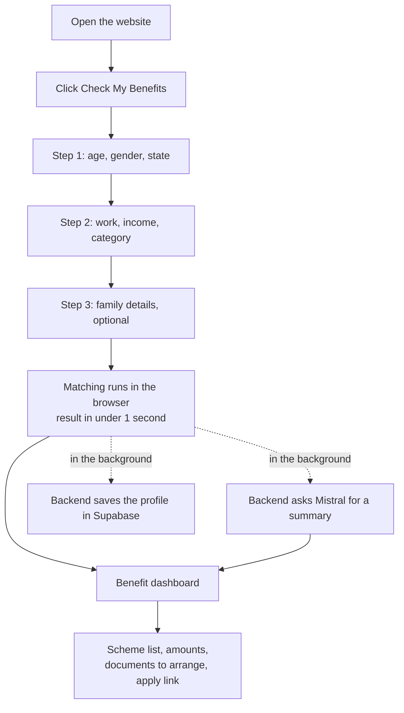
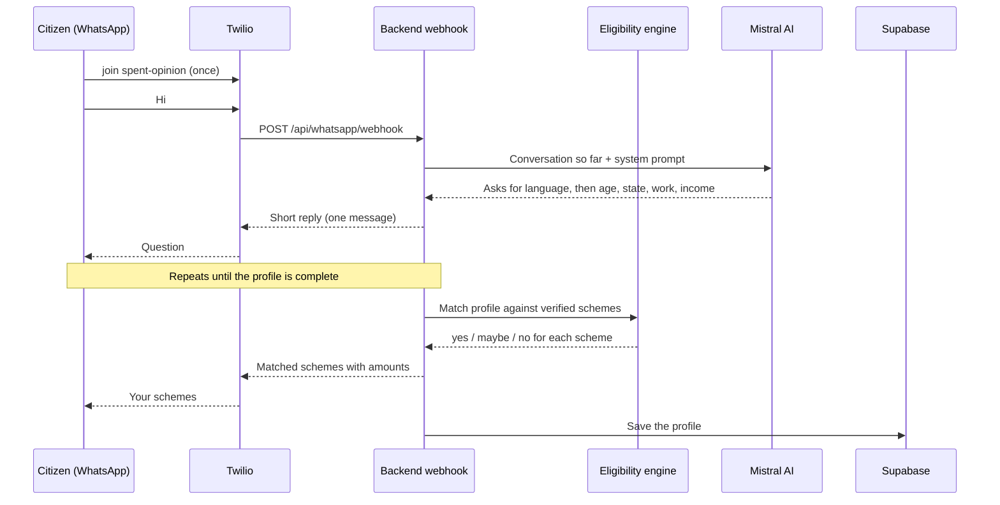
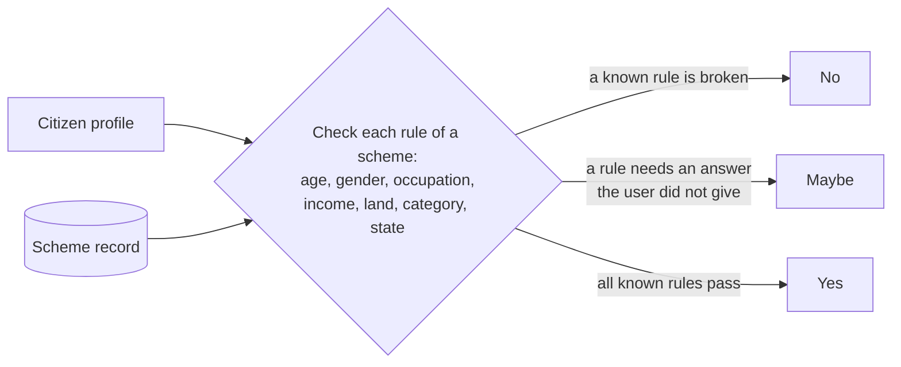
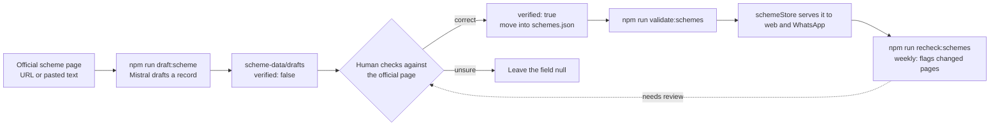

# BharatSahayak 🇮🇳

**An AI companion that tells Indian citizens which government schemes they qualify for, on the web and on WhatsApp, in Hindi, Marathi and English.**

Built for **Catalyst Hack 2026** by Team **Binary-Builders** (Generative AI).

| | |
|---|---|
| **Live project** | _AWS link: to be added after deployment_ |
| **Repository** | https://github.com/PawanBhandari03/BharatSahayak-Catalyst |
| **WhatsApp bot** | Send `join spent-opinion` to **+1 415 523 8886** (Twilio sandbox), then say `Hi` |
| **Team** | Pawansingh Jagdish Bhandari · Rahul H. Bramhankar |

---

## 1. Problem statement

India runs hundreds of welfare schemes, but a large share of eligible people never claim them. They don't know a scheme exists, the portals are hard to navigate, and the rules (age, income, occupation, category, state) are hard to check by hand. A widow farmer in Osmanabad with a keypad phone has no easy way to learn that she qualifies for several schemes at once.

**BharatSahayak turns that into a short conversation.** The citizen answers a few simple questions on the website, or just chats on WhatsApp, and gets a clear list of schemes they match, with the amount, the documents to arrange, and an official link to apply.

## 2. Key features

| Feature | Status |
|---|---|
| 3-step web form (only 5 answers are required, no Aadhaar number, no OTP, no password) | Working |
| Instant matching in the browser (results in under a second) | Working |
| Benefit dashboard with matched schemes, amounts and documents to arrange | Working |
| AI recommendations: top schemes, a personal message, documents checklist (Mistral AI) | Working |
| WhatsApp bot: language choice, conversational questions, matched schemes in chat | Working |
| Profiles and recommendations saved in a database (Supabase PostgreSQL) | Working |
| One shared eligibility engine used by the web app and the WhatsApp bot | Working |
| Scheme data layer: JSON schema, validator, AI-drafting script and re-check job | Built, needs human verification of records |
| Demo mode: a **Fill demo data** button on every form step (3 personas) | Working |
| Voice call (Twilio Voice) | Code exists, **not live** (it needs a paid Twilio plan) |
| Proactive deadline alerts | **Planned**, not built |

> Honest note on the data: the dataset has **50 schemes** (central and Maharashtra), of which **7 are verified** against their official pages (see `scheme-data/NEEDS_REVIEW.md`). The other 43 are drafted and still need a person to check them (checklist: `scheme-data/VERIFICATION_CHECKLIST.md`) before they are marked `verified: true`. See [`scheme-data/NEEDS_REVIEW.md`](scheme-data/NEEDS_REVIEW.md).

## 3. Technology stack

| Layer | Technology |
|---|---|
| Frontend | React, Vite, Tailwind CSS, Framer Motion |
| Backend | Node.js, Express |
| Database | Supabase (PostgreSQL) |
| AI | Mistral AI (`open-mistral-nemo` by default, works on the free tier) |
| Messaging | Twilio WhatsApp (sandbox) |
| Eligibility | Shared pure-JavaScript engine (`shared/eligibility.mjs`) |
| Hosting | AWS (see section 7) |

## 4. How it works

### 4.1 System architecture



### 4.2 Web user flow



Results never wait for the AI or the database. The matching is local, and the AI summary and the save happen afterwards.

### 4.3 WhatsApp conversation



### 4.4 Eligibility engine

One set of rules is used by the web app and the WhatsApp bot, so both give the same answer.



A rule set to `null` never excludes anyone. A missing answer gives **maybe** and is never guessed.

### 4.5 Scheme data pipeline



AI drafts, a person verifies, and only verified records are used to advise anyone (unless `INCLUDE_UNVERIFIED=true` is set for local demos).

## 5. Implementation details

**Repository layout**

```
frontend/            React app (pages, components, demo personas, scheme matcher)
backend/
  server.js          Express entry point
  routes/            schemes, whatsapp, call (voice)
  controllers/       match, AI recommendation, user registration
  services/          schemeStore, eligibility, replyFormat, twilioService
  db/schema.sql      Supabase tables
  test/              automated tests (node --test)
shared/              eligibility.mjs, used by both frontend and backend
scheme-data/         schemes.json, JSON schema, review checklist
scripts/             validate, draft and re-check scripts for scheme data
docs/                Twilio setup guide, handoff notes
```

**API**

| Method and path | Purpose |
|---|---|
| `GET /health` | Health check |
| `GET /api/schemes` | All usable schemes (one source for web, WhatsApp and voice) |
| `GET /api/schemes/:id` | One scheme |
| `POST /api/match-schemes` | Match a profile on the server |
| `POST /api/ai-recommend` | AI summary for a profile, and saves it to Supabase |
| `POST /api/whatsapp/webhook` | Twilio calls this for each incoming WhatsApp message |

**Design choices**

- **A dataset we own, not a live API.** There is no confirmed public API for scheme eligibility, and wrong advice harms people. Every record has an official link and a verification date.
- **Matching in the browser.** Results appear instantly, and the site still works if the AI or database is slow.
- **Free-tier friendly.** The default AI model, the database and the hosting plan all fit free plans.
- **No secrets in the repository.** Keys live in `.env` files, which are ignored by git. See `.env.example`.

**Tests:** `cd backend && npm test` runs 28 tests covering the eligibility engine, the scheme store, the re-check job, the WhatsApp reply formatting and the Twilio message cap.

## 6. Setup and usage

**Requirements:** Node.js 18 or newer, a Supabase project, a Mistral API key. A Twilio account is optional (WhatsApp only).

```bash
git clone https://github.com/PawanBhandari03/BharatSahayak-Catalyst.git
cd BharatSahayak-Catalyst

# 1. Backend
cd backend
cp .env.example .env          # then fill in the values
npm install
npm start                     # http://localhost:5000

# 2. Frontend (new terminal)
cd frontend
cp .env.example .env          # VITE_API_URL=http://localhost:5000
npm install
npm run dev                   # http://localhost:5173
```

**Database:** open the Supabase SQL Editor and run [`backend/db/schema.sql`](backend/db/schema.sql) once.

**Environment variables (`backend/.env`)**

| Variable | Meaning |
|---|---|
| `PORT` | Server port (default 5000) |
| `INCLUDE_UNVERIFIED` | `true` to use schemes not yet marked verified (local demos) |
| `MISTRAL_API_KEY`, `MISTRAL_MODEL` | AI key and model (`open-mistral-nemo` works on the free tier) |
| `SUPABASE_URL`, `SUPABASE_SERVICE_KEY` | Database connection (use the secret key, only on the server) |
| `TWILIO_ACCOUNT_SID`, `TWILIO_AUTH_TOKEN`, `TWILIO_WHATSAPP_FROM` | WhatsApp (optional) |

**Using the app**

1. Open the site and click **Check My Benefits**.
2. For a quick demo, click **Fill demo data** on each step (pick Savitribai, Aarav or Rahul), then **Continue**.
3. See the matched schemes on the dashboard.
4. For WhatsApp, click **Try on WhatsApp**, scan the QR code, send `join spent-opinion`, then say `Hi`.

**WhatsApp setup:** see [`docs/TWILIO_SETUP.md`](docs/TWILIO_SETUP.md). The Twilio sandbox needs the webhook set to `https://<your-backend>/api/whatsapp/webhook`, and testers have to re-send the join message about every 3 days.

**Adding or checking schemes**

```bash
cd backend
npm run draft:scheme       # draft a record from an official page (needs the Mistral key)
npm run validate:schemes   # schema, source links, stale dates
npm run recheck:schemes    # compare stored records with the official pages
```

## 7. AWS deployment

_This section is filled in after deployment._

| Item | Value |
|---|---|
| Region | _to be added_ |
| Frontend | _to be added_ |
| Backend | _to be added_ |
| Live link | _to be added_ |

## 8. Screenshots

_Screenshots of the working project are added in `docs/screenshots/` and listed here after deployment._

## 9. Future scope

- Verify and grow the dataset to about 50 central and state schemes, with a human review step for each.
- Weekly re-check of official pages, with changed schemes flagged for review.
- Proactive reminders before scheme deadlines and after life events.
- Voice calls for people with keypad phones, in their own language.
- Apply for official data access (API Setu / myScheme) to scale beyond a curated list.
- The citizen always uses it free. Revenue would come from state departments, CSC operators and CSR sponsors.

## 10. Team

**Binary-Builders**: Pawansingh Jagdish Bhandari and Rahul H. Bramhankar. Domain: Generative AI.

## License

MIT. See [LICENSE](LICENSE).
