# BharatSahayak V2

**An AI companion that tells Indian citizens which government schemes they qualify for, on the web and on WhatsApp, in Hindi, Marathi and English.**

Built for **Catalyst Hack 2026** by Team **Binary Builders** (Generative AI).

This is **V2**, the rebuilt version of the original BharatSahayak (V1). V2 adds the shared matching rules, the 50-scheme dataset, the WhatsApp bot, Hindi and Marathi support and AWS deployment.

| | |
|---|---|
| **Live project** | https://d21lokneek591y.cloudfront.net (hosted on AWS) |
| **Repository** | https://github.com/PawanBhandari03/BharatSahayak-Catalyst |
| **WhatsApp bot** | Send `join spent-opinion` to **+1 415 523 8886** (Twilio sandbox), then say `Hi` |
| **Team** | Pawansingh Jagdish Bhandari · Rahul H. Bramhankar |

---

## 1. Problem statement

India runs hundreds of welfare schemes, but a large share of eligible people never claim them. They don't know a scheme exists, the portals are hard to navigate, and the rules (age, income, occupation, category, state) are hard to check by hand. A widow farmer in Osmanabad with a keypad phone has no easy way to learn that she qualifies for several schemes at once.

**BharatSahayak turns that into a short conversation.** The citizen answers a few simple questions on the website, or just chats on WhatsApp, and gets a clear list of schemes they match, with the amount, the documents to arrange, and an official link to apply.

## 2. Key features

| Feature | Status |
|---|---|
| 3-step web form (only 5 answers are required, no Aadhaar number, no OTP, no password) | Working |
| Instant matching in the browser (results in under a second) | Working |
| Benefit dashboard with matched schemes, amounts and documents to arrange | Working |
| AI recommendations: top schemes, a personal message, documents checklist (Mistral AI) | Working |
| WhatsApp bot: language choice, conversational questions, matched schemes in chat | Working |
| Profiles and recommendations saved in a database (Supabase PostgreSQL) | Working |
| Website in English, Hindi and Marathi (interface text written with AI; scheme descriptions are mostly English) | Working |
| Live on AWS (EC2 + CloudFront, HTTPS) | Working |
| One shared eligibility engine used by the web app and the WhatsApp bot | Working |
| Scheme data layer: JSON schema, validator, AI-drafting script and re-check job | Working |
| Demo mode: a **Fill demo data** button on every form step (3 personas) | Working |
| Voice call (Twilio Voice) | Code exists, **not live** (it needs a paid Twilio plan) |
| Proactive deadline alerts | **Planned**, not built |

## 3. Technology stack

| Layer | Technology |
|---|---|
| Frontend | React, Vite, Tailwind CSS, Framer Motion |
| Backend | Node.js, Express |
| Database | Supabase (PostgreSQL) |
| AI | Mistral AI (`open-mistral-nemo` by default, works on the free tier) |
| Messaging | Twilio WhatsApp (sandbox) |
| Eligibility | Shared pure-JavaScript engine (`shared/eligibility.mjs`) |
| Hosting | AWS (see section 7) |

## 4. How it works

### 4.1 System architecture

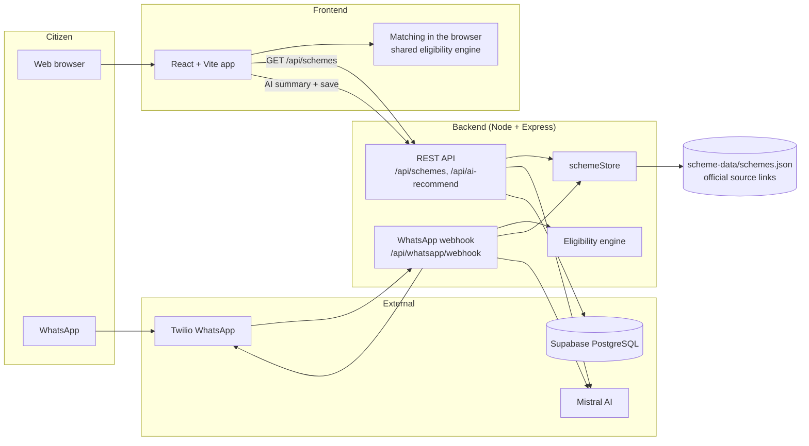

### 4.2 Web user flow

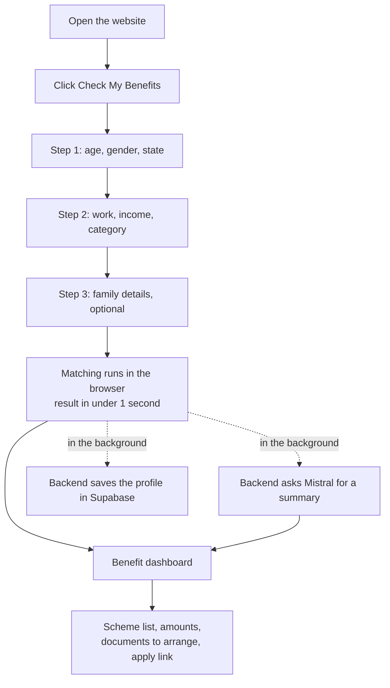

Results never wait for the AI or the database. The matching is local, and the AI summary and the save happen afterwards.

### 4.3 WhatsApp conversation

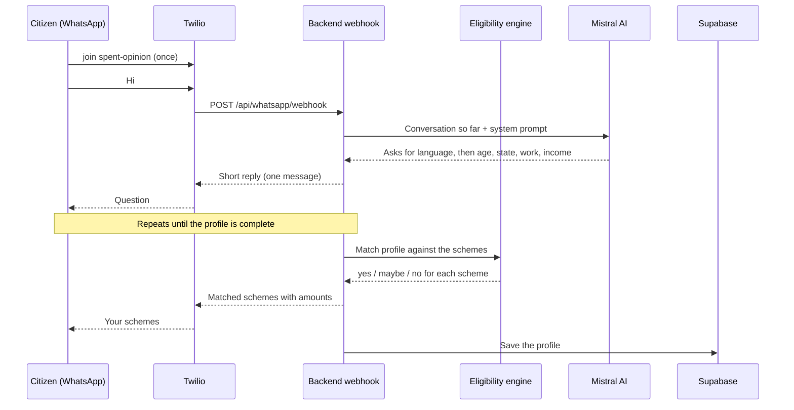

### 4.4 Eligibility engine

One set of rules is used by the web app and the WhatsApp bot, so both give the same answer.

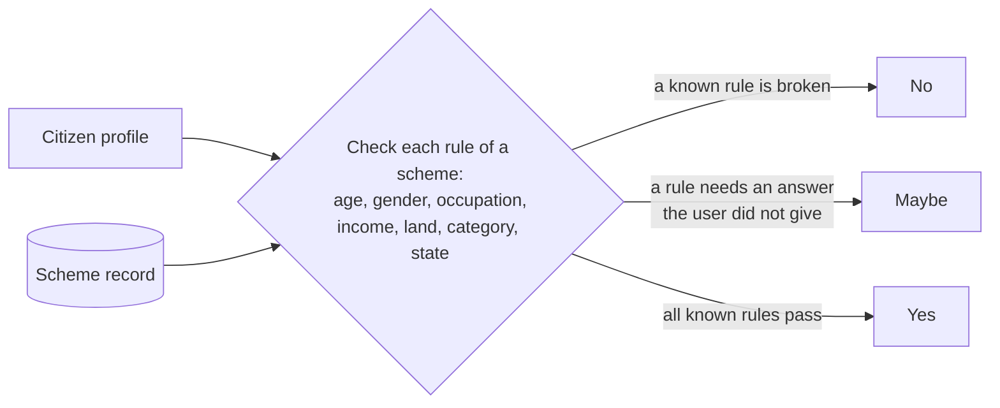

A rule set to `null` never excludes anyone. A missing answer gives **maybe** and is never guessed.

### 4.5 Scheme data pipeline

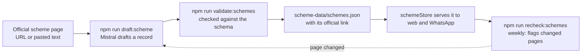

AI drafts each record from its official page, the validator checks the format, and a weekly re-check flags pages that have changed.

## 5. Implementation details

**Repository layout**

```
frontend/            React app (pages, components, demo personas, scheme matcher)
backend/
  server.js          Express entry point
  routes/            schemes, whatsapp, call (voice)
  controllers/       match, AI recommendation, user registration
  services/          schemeStore, eligibility, replyFormat, twilioService
  db/schema.sql      Supabase tables
  test/              automated tests (node --test)
shared/              eligibility.mjs, used by both frontend and backend
scheme-data/         schemes.json and its JSON schema
scripts/             validate, draft and re-check scripts for scheme data
docs/                BharatSahayak_Documentation.pdf (full project documentation, including the WhatsApp setup)
```

**API**

| Method and path | Purpose |
|---|---|
| `GET /health` | Health check |
| `GET /api/schemes` | All usable schemes (one source for web, WhatsApp and voice) |
| `GET /api/schemes/:id` | One scheme |
| `POST /api/match-schemes` | Match a profile on the server |
| `POST /api/ai-recommend` | AI summary for a profile, and saves it to Supabase |
| `POST /api/whatsapp/webhook` | Twilio calls this for each incoming WhatsApp message |

**Design choices**

- **A dataset we own, not a live API.** There is no confirmed public API for scheme eligibility, and wrong advice harms people. Every record carries an official source link.
- **Matching in the browser.** Results appear instantly, and the site still works if the AI or database is slow.
- **Free-tier friendly.** The default AI model, the database and the hosting plan all fit free plans.
- **No secrets in the repository.** Keys live in `.env` files, which are ignored by git. See `.env.example`.

**Tests:** `cd backend && npm test` runs 31 tests covering the eligibility engine, the scheme store, the re-check job, the WhatsApp reply formatting and the Twilio message cap.

## 6. Setup and usage

**Requirements:** Node.js 18 or newer, a Supabase project, a Mistral API key. A Twilio account is optional (WhatsApp only).

```bash
git clone https://github.com/PawanBhandari03/BharatSahayak-Catalyst.git
cd BharatSahayak-Catalyst

# 1. Backend
cd backend
cp .env.example .env          # then fill in the values
npm install
npm start                     # http://localhost:5000

# 2. Frontend (new terminal)
cd frontend
cp .env.example .env          # VITE_API_URL=http://localhost:5000
npm install
npm run dev                   # http://localhost:5173
```

**Database:** open the Supabase SQL Editor and run [`backend/db/schema.sql`](backend/db/schema.sql) once.

**Environment variables (`backend/.env`)**

| Variable | Meaning |
|---|---|
| `PORT` | Server port (default 5000) |
| `MISTRAL_API_KEY`, `MISTRAL_MODEL` | AI key and model (`open-mistral-nemo` works on the free tier) |
| `SUPABASE_URL`, `SUPABASE_SERVICE_KEY` | Database connection (use the secret key, only on the server) |
| `TWILIO_ACCOUNT_SID`, `TWILIO_AUTH_TOKEN`, `TWILIO_WHATSAPP_FROM` | WhatsApp (optional) |

**Using the app**

1. Open the site and click **Check My Benefits**.
2. For a quick demo, click **Fill demo data** on each step (pick Savitribai, Aarav or Rahul), then **Continue**.
3. See the matched schemes on the dashboard.
4. For WhatsApp, click **Try on WhatsApp**, scan the QR code, send `join spent-opinion`, then say `Hi`.

**WhatsApp setup:** see "WhatsApp setup (Twilio sandbox)" in the project documentation, [`docs/BharatSahayak_Documentation.pdf`](docs/BharatSahayak_Documentation.pdf). The Twilio sandbox needs the webhook set to `https://<your-backend>/api/whatsapp/webhook`, and testers have to re-send the join message about every 3 days.

**Adding or checking schemes**

```bash
cd backend
npm run draft:scheme       # draft a record from an official page (needs the Mistral key)
npm run validate:schemes   # schema, source links, stale dates
npm run recheck:schemes    # compare stored records with the official pages
```

## 7. AWS deployment

The whole app runs on AWS, using services from the free tier and the account's free credits.

| Item | Value |
|---|---|
| Region | Asia Pacific (Sydney), `ap-southeast-2` |
| Compute | **Amazon EC2** `t3.micro`, Amazon Linux 2023. Node.js runs the Express API **and** serves the built React website, kept alive by `pm2` |
| HTTPS and CDN | **Amazon CloudFront** distribution in front of the EC2 instance (origin: HTTP port 5000, caching disabled so the API always answers live) |
| Network | EC2 security group: SSH (22) and the app port (5000) |
| Cost control | AWS Budgets alert (zero-spend template) |
| Live link | https://d21lokneek591y.cloudfront.net |

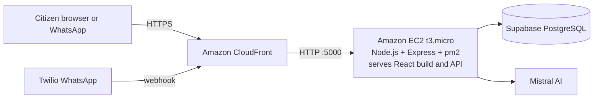

**How it was deployed**

1. Launched the EC2 instance and opened port 5000 in its security group.
2. Ran [`deploy/setup-ec2.sh`](deploy/setup-ec2.sh) once: installs Node.js 20, git and pm2, adds swap, and clones this repository.
3. Put the keys in `backend/.env` on the server (never in git).
4. Ran [`deploy/update.sh`](deploy/update.sh): pulls the latest code, builds the React app, and (re)starts the server with pm2.
5. Created the CloudFront distribution so the site is served over HTTPS (Twilio and browsers need HTTPS).

To release an update, push to `main`, then run `bash BharatSahayak-Catalyst/deploy/update.sh` on the instance.

## 8. Screenshots

Captured from the working project (live link in section 7). The demo data is the "Savitribai" persona.

| | |
|---|---|
| **Home page**<br>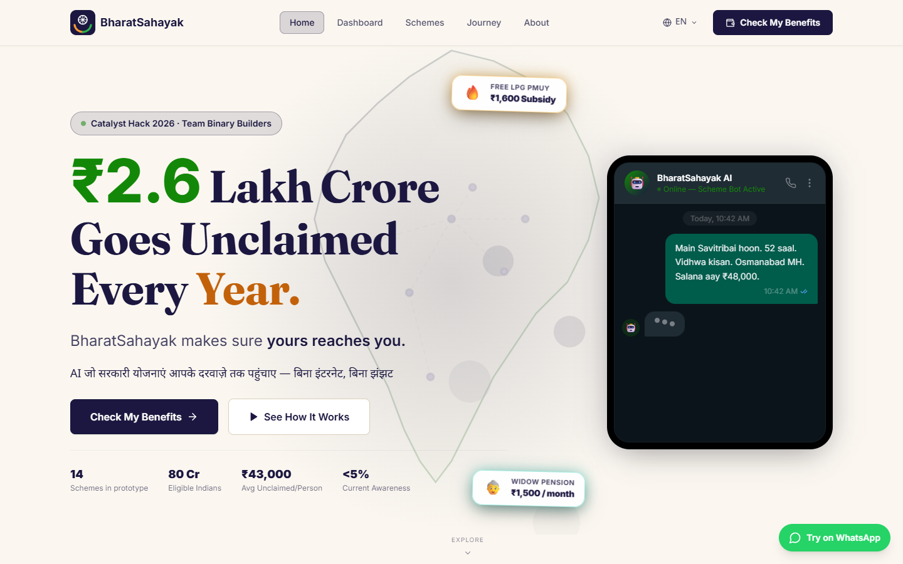 | **Home page in Hindi**<br>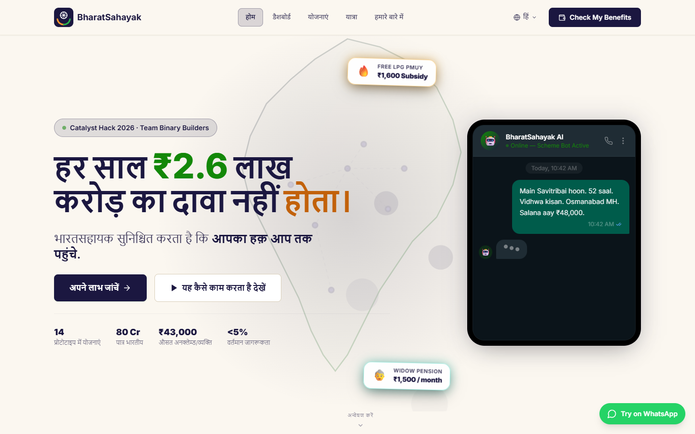 |
| **WhatsApp bot: scan the QR code**<br>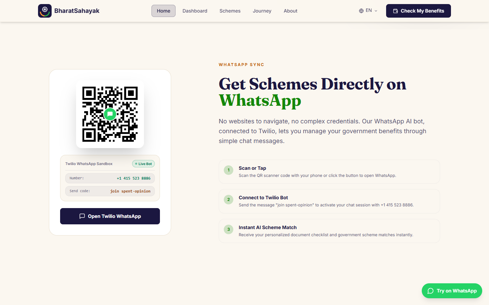 | **Form, step 1 (Fill demo data)**<br>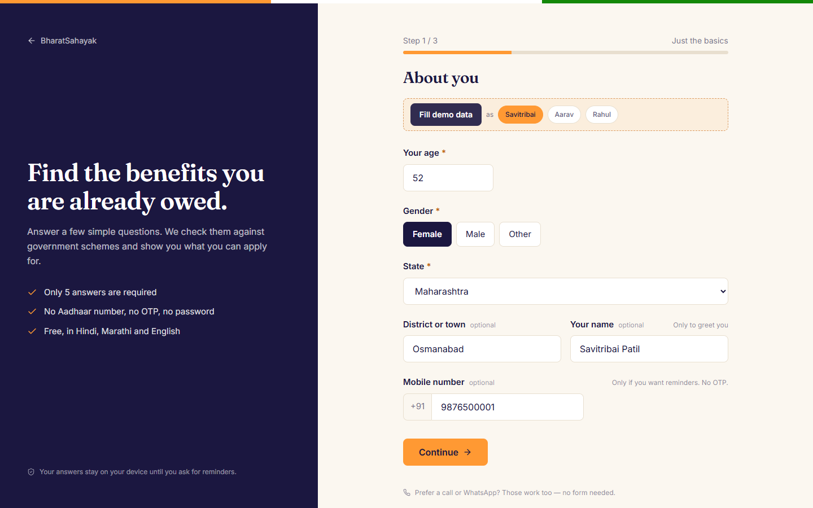 |
| **Form, step 2**<br>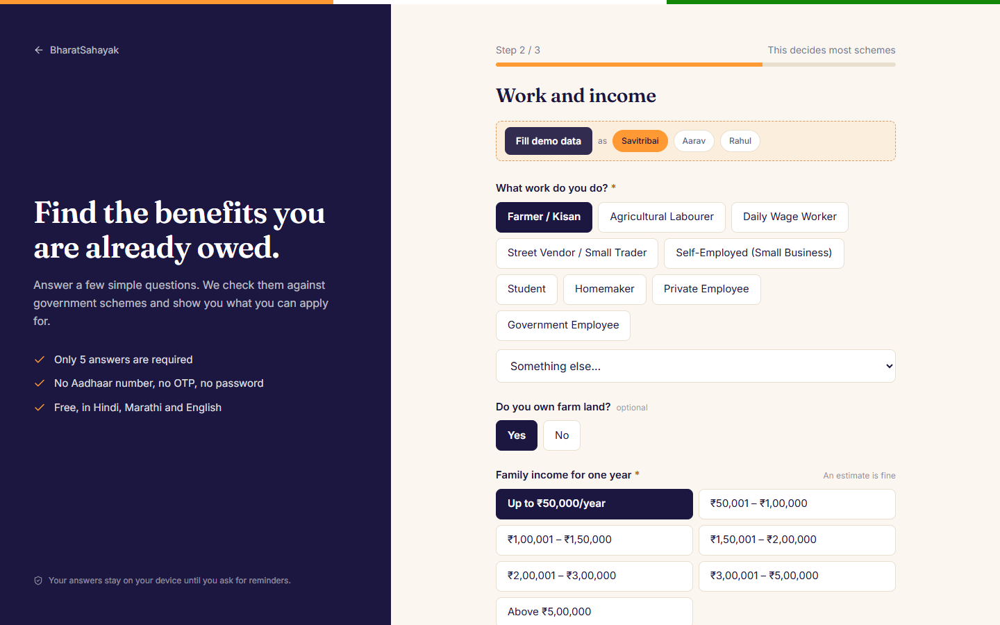 | **Benefit dashboard with the AI summary**<br>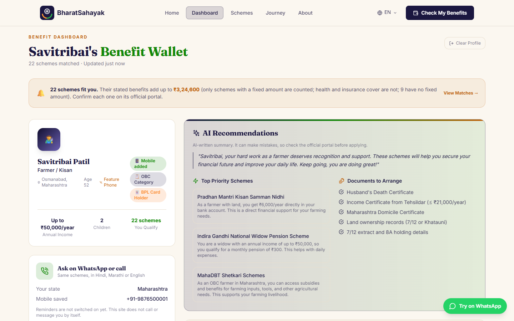 |
| **Dashboard: matched schemes**<br>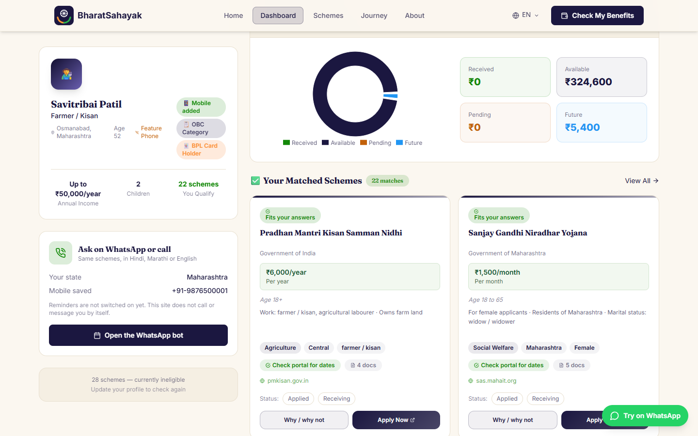 | **All schemes, with filters**<br>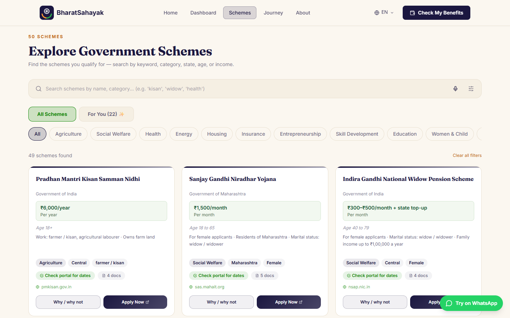 |
| **Journey page**<br>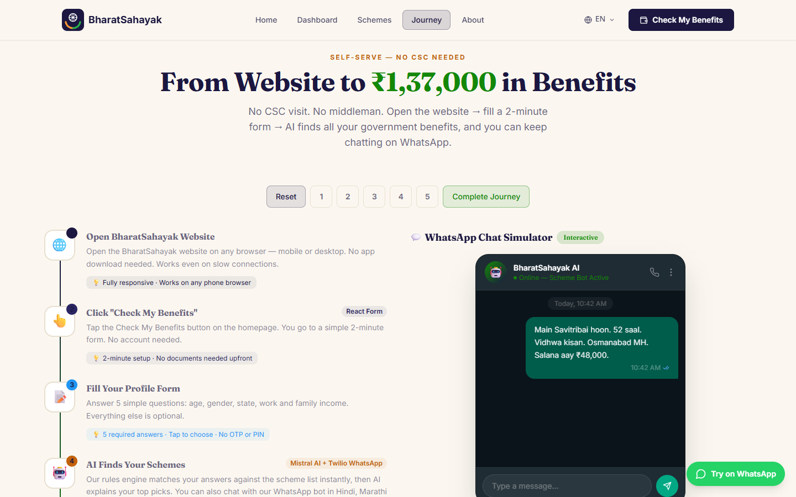 | **About the team**<br>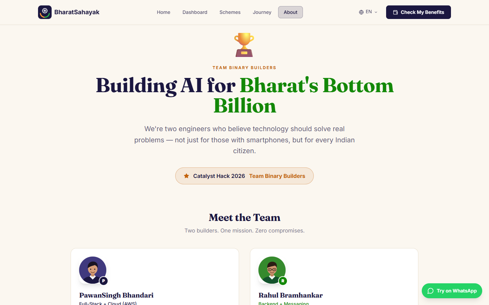 |

## 9. Future scope

- Grow the dataset with more central and state schemes.
- Weekly re-check of official pages, with changed schemes flagged for review.
- Proactive reminders before scheme deadlines and after life events.
- Voice calls for people with keypad phones, in their own language.
- Apply for official data access (API Setu / myScheme) to scale beyond a curated list.
- The citizen always uses it free. Revenue would come from state departments, CSC operators and CSR sponsors.

## 10. Team

**Binary Builders**: Pawansingh Jagdish Bhandari and Rahul H. Bramhankar. Domain: Generative AI.

## License

MIT. See [LICENSE](LICENSE).
