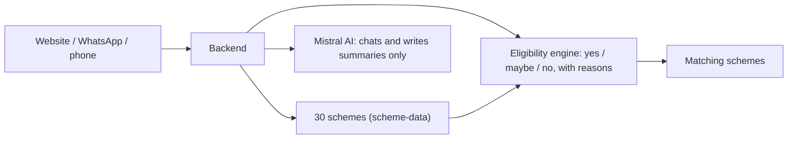

# BharatSahayak 🇮🇳

**Find the government benefits you may qualify for, in Hindi, Marathi or English.**
Built for Catalyst Hack 2026 by Team Binary Builders (PawanSingh Jagdish Bhandari, Rahul H. Bramhankar).

Many people never receive welfare schemes they are entitled to, because nobody tells them. BharatSahayak asks five simple questions
(age, gender, state, work, income) and lists the schemes the person may qualify for, with the documents needed and the official link.

## Ways to use it

| Channel | How | Status |
|---|---|---|
| Website | 3-step form, no Aadhaar / OTP / password, results in under a second | Working |
| WhatsApp bot | Chat in Hindi, Marathi or English (Twilio sandbox) | Working |
| Phone call | Greeting and answers from the scheme list | Prototype (no speech recognition yet) |

## How it works, in one picture



The AI only talks to the person. **A rules engine decides which schemes match**, so the AI cannot invent schemes.

## Quick start

Needs Node.js 22 or newer.

```bash
cd backend && npm install && cp .env.example .env     # add MISTRAL_API_KEY, then:
npm start                                              # http://localhost:5000

cd frontend && npm install && cp .env.example .env
npm run dev                                            # http://localhost:5173
```

Demo: open `http://localhost:5173/register?demo=1` and click a persona. Run `npm test` in `backend/` (29 tests).

## Please note (honest status)

- The 30 schemes are **not yet verified by a human** against official pages. Doubtful items are in `scheme-data/NEEDS_REVIEW.md`.
- Hindi and Marathi text was written by AI and needs a native-speaker check.
- Reminders, speech recognition on calls and a database are **not built yet**.

## Documentation

- **[Full project documentation](docs/PROJECT_DOCUMENTATION.md)**: architecture, flowcharts, data, setup, limits
- [Twilio / WhatsApp setup](docs/TWILIO_SETUP.md)
- [Pitch script and demo checklist](docs/PITCH_SCRIPT_V2.md)

License: see [LICENSE](LICENSE).
