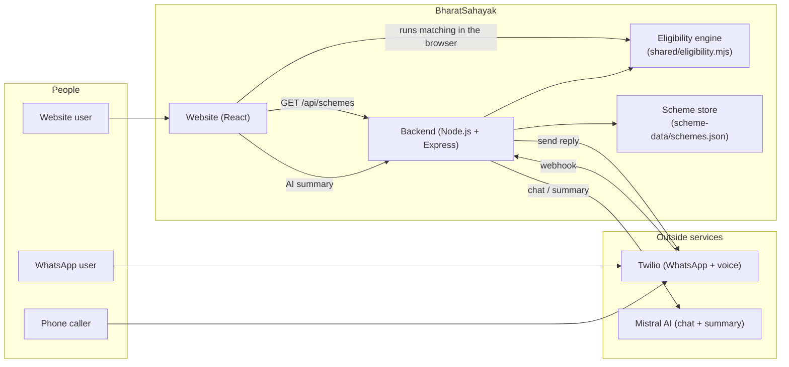
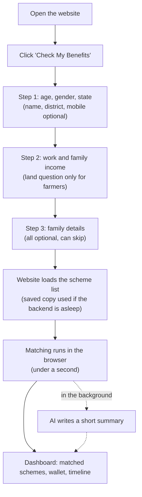
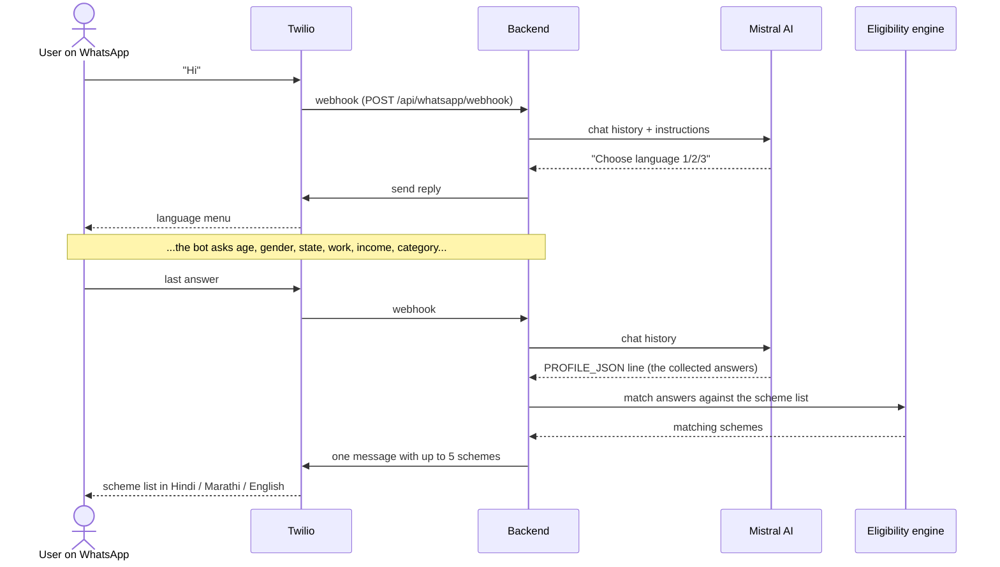
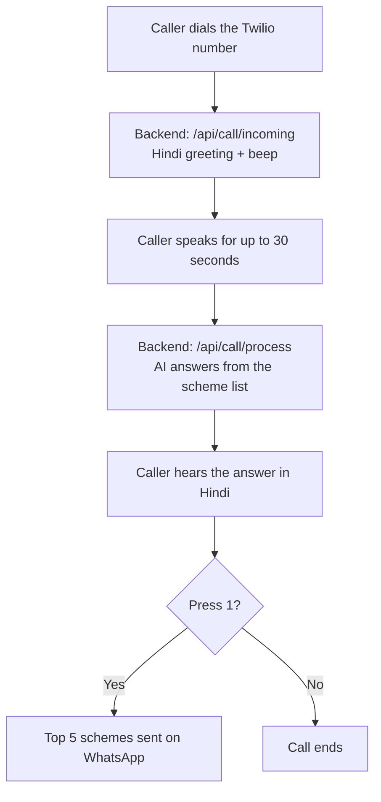
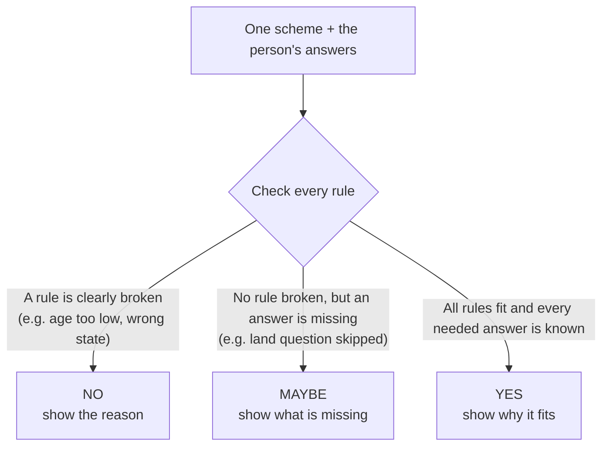
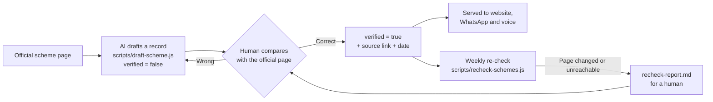

# BharatSahayak: Full Project Documentation

*Team Binary Builders (PawanSingh Jagdish Bhandari, Rahul H. Bramhankar) · Catalyst Hack 2026*

This document explains the whole project in simple words: what it does, how it works, how to run it, and what is still missing.
The diagrams are written in Mermaid and show up automatically on GitHub.

---

## 1. What is BharatSahayak?

Many people do not receive government benefits they are entitled to, because they never find out about them.
BharatSahayak asks a few simple questions (age, gender, state, work, income) and tells the person **which government schemes they may qualify for**, in **Hindi, Marathi or English**.

A person can use it in three ways:

| Channel | How | Status |
|---|---|---|
| **Website** | Fill a 3-step form, see matching schemes at once | Working |
| **WhatsApp bot** | Chat with the bot, it asks the questions and lists schemes | Working (Twilio sandbox) |
| **Phone call** | Call a number, hear a greeting, get answers | Greeting and answers work; speech recognition not built |

**Our example person:** Savitribai, 52, a widow and farmer in Osmanabad, Maharashtra, with a basic phone.

---

## 2. What works today, and what does not

Honesty first. Please read this before the demo.

| Part | Status |
|---|---|
| 3-step registration form, only 5 required answers (no Aadhaar, no OTP, no password) | Working |
| 30 schemes (central + Maharashtra) shared by website, WhatsApp and voice | Working, but **not yet checked by a human against official pages** |
| One eligibility engine with answers "yes", "maybe" or "no" and the reason | Working, tested |
| Hindi, Marathi, English names and benefit lines for every scheme | Working, **written by AI, needs a native-speaker check** |
| Benefit Wallet (received, available, pending, future) from real data | Working |
| Life Timeline built from scheme rules | Working |
| AI summary of the top schemes | Working, but a small AI model can make mistakes |
| Weekly re-check of verified schemes against official pages | Built; **not yet proven on live government sites** (see section 10) |
| Reminders and deadline alerts | **Not built** |
| Speech recognition on phone calls | **Not built** |
| A database that saves users | **Not built** (optional, see section 13) |

---

## 3. The big picture



The key idea: **one list of schemes and one set of rules** feed all three channels. The AI only talks to the user; **the rules decide which schemes match**. This keeps answers consistent and stops the AI from inventing schemes.

---

## 4. How a person uses each channel

### 4.1 Website



- **Required:** age, gender, state, work, income range. Everything else can be skipped.
- **Demo mode:** open `/register?demo=1` and click *Savitribai*, *Aarav* or *Rahul* to fill the form and jump to results.
- Your answers are saved only in your browser (to resume the form) and are sent to our server only for the AI summary.

### 4.2 WhatsApp



Why this design: earlier, the AI picked schemes itself and made mistakes (it showed women-only schemes to a man and invented a scheme). Now the AI only collects answers and hands them over; **our rules pick the schemes**.

Safety limits built in:
- Each reply is cut to fit WhatsApp's 1,600-character limit, so it stays **one message**.
- A daily cap (`WHATSAPP_DAILY_CAP`, default 80) stops the server before the free Twilio allowance runs out.

### 4.3 Phone call (prototype)



**Limit:** the recording is **not** turned into text yet, so the AI does not know what the caller said. It answers from the general scheme list. Speech recognition is the next step. This path has not been tested with a real phone call.

---

## 5. How matching works

Every scheme has simple rules: minimum and maximum age, gender, state, work, category, marital status, income limit, and whether it needs farm land or a BPL card. A rule that is empty means "no limit".



Details that matter:
- **Income ranges.** The form asks for a range (for example 2,00,001 to 3,00,000). If a scheme's limit falls *inside* the range, the result is "maybe", not "no".
- **Missing answers never guess.** They give "maybe" and list what is missing.
- The same file, `shared/eligibility.mjs`, is used by the website and the backend, so there is no second copy of the rules.
- Results are sorted "yes" first, then by how specific the scheme is for that person (their state, work or gender).

**Benefit Wallet** (all computed from real data):

| Bucket | Meaning |
|---|---|
| Received | Schemes the user marked "Receiving" |
| Pending | Schemes the user marked "Applied" |
| Available | "Yes" and "maybe" schemes not yet marked (only schemes with a fixed rupee amount are added) |
| Future | Schemes that open at an older age, found by re-running the rules at that age |

---

## 6. Scheme data: where it comes from and how it stays correct

There is **no public official API** for scheme eligibility that we could confirm, so we keep our own list, one record per scheme, each with an official link.



Rules we follow:
- Only records with `verified: true` are served to users. (For the demo we set `INCLUDE_UNVERIFIED=true`, because **none of the 30 are verified yet**.)
- The re-check job **never edits the scheme file**. It only writes a report.
- Unknown values are `null`, never guessed. Doubtful records are listed in `scheme-data/NEEDS_REVIEW.md`.

**What a scheme record contains**

| Field | Meaning |
|---|---|
| `id` | Short unique name, e.g. `pm-kisan` |
| `name`, `benefitSummary` | Text in English, Hindi, Marathi |
| `category`, `level`, `state` | Topic, central or state, and which state (`all` for the whole country) |
| `amount`, `frequency` | Rupees, and one-time / monthly / yearly |
| `eligibility` | The rules (age, gender, occupations, income limit, land, marital status, categories, BPL) |
| `documents`, `howToApply`, `deadline` | Practical help for the applicant |
| `officialUrl`, `sourceUrl` | Official site and the page the record was checked against |
| `verified`, `lastVerified` | Set to true only by a human, with the date |

The exact format is in `scheme-data/scheme.schema.json`, checked by `npm run validate:schemes`.

---

## 7. Project folders

```
BharatSahayak-Catalyst/
├── README.md                    short overview
├── docs/
│   ├── PROJECT_DOCUMENTATION.md this file
│   ├── TWILIO_SETUP.md          step-by-step Twilio sandbox setup
│   └── PITCH_SCRIPT_V2.md       presentation script and demo checklist
├── backend/                     Node.js + Express server
│   ├── server.js                starts the server, mounts the routes
│   ├── routes/                  whatsapp.js, call.js, schemes.js
│   ├── controllers/             schemeController.js (match + AI summary)
│   ├── services/                schemeStore, eligibility, replyFormat, twilioService
│   ├── prompts/systemPrompt.js  instructions given to the AI
│   ├── config/supabase.js       optional database connection
│   └── test/                    automated tests
├── frontend/                    React website (Vite + Tailwind)
│   └── src/
│       ├── pages/               Home, Register, Dashboard, Schemes, Journey, About
│       ├── components/          cards, wallet, timeline, navbar, footer
│       ├── context/             SchemesContext (loads schemes), UserContext
│       ├── services/schemeApi.js talks to the backend, saves a cached copy
│       ├── utils/schemeMatcher.js  matching, wallet, timeline (uses the shared engine)
│       └── demo/personas.js     Savitribai, Aarav, Rahul for the demo
├── shared/eligibility.mjs       the one set of matching rules
├── scheme-data/
│   ├── schemes.json             the 30 schemes
│   ├── scheme.schema.json       the exact format of a record
│   ├── NEEDS_REVIEW.md          what a human must check
│   └── TODO_SCHEMES.md          schemes still to add
└── scripts/                     validate-schemes, draft-scheme, recheck-schemes
```

---

## 8. Backend endpoints

| Method | Path | What it does |
|---|---|---|
| GET | `/health` | Returns `{"ok":true}` (used to check the server and keep it awake) |
| GET | `/api/schemes` | All schemes (verified only, unless `INCLUDE_UNVERIFIED=true`) |
| GET | `/api/schemes/:id` | One scheme |
| POST | `/api/match-schemes` | Matches a profile against the schemes |
| POST | `/api/ai-recommend` | AI summary of the top schemes |
| POST | `/api/whatsapp/webhook` | Twilio sends incoming WhatsApp messages here |
| POST | `/api/whatsapp/send-text`, `/send-template` | Send a WhatsApp message (tools for testing) |
| POST | `/api/call/incoming`, `/process`, `/keypress` | The phone-call steps |

Website pages: `/` Home · `/register` form · `/dashboard` results · `/schemes` all schemes · `/journey` how it works · `/about` team.

---

## 9. Technology used

| Part | Technology |
|---|---|
| Website | React 18, Vite, Tailwind CSS, Framer Motion, Recharts |
| Backend | Node.js 22 or newer, Express 5 |
| AI | Mistral AI (free tier model `open-mistral-nemo`; a paid plan can use `mistral-large-latest`) |
| WhatsApp and voice | Twilio (WhatsApp sandbox, voice) |
| Public link to a local server | ngrok |
| Optional database | Supabase (PostgreSQL), not required |
| Tests | Node's built-in test runner |

---

## 10. How to run it

**You need:** Node.js 22 or newer, a Mistral API key, and (for WhatsApp) a Twilio account.

```bash
# 1. Backend
cd backend
npm install
cp .env.example .env        # then fill in the values below
npm start                   # runs on http://localhost:5000

# 2. Website (second terminal)
cd frontend
npm install
cp .env.example .env        # VITE_API_URL=http://localhost:5000
npm run dev                 # runs on http://localhost:5173
```

**Settings in `backend/.env`** (never commit this file; it is ignored by git)

| Setting | Needed? | Meaning |
|---|---|---|
| `PORT` | no | Server port, default 5000 |
| `INCLUDE_UNVERIFIED` | for the demo | `true` serves schemes that no human has verified yet |
| `MISTRAL_API_KEY` | yes | AI key |
| `MISTRAL_MODEL` | no | AI model name |
| `TWILIO_ACCOUNT_SID`, `TWILIO_AUTH_TOKEN` | for WhatsApp/voice | From the Twilio console |
| `TWILIO_WHATSAPP_FROM` | for WhatsApp | e.g. `whatsapp:+14155238886` |
| `WHATSAPP_DAILY_CAP` | no | Max WhatsApp messages sent per day, default 80 |
| `SUPABASE_URL`, `SUPABASE_SERVICE_KEY` | no | Only if you add a database |

**WhatsApp:** follow `docs/TWILIO_SETUP.md` (public tunnel, sandbox webhook, joining the sandbox).

**Useful commands (run in `backend/`)**

| Command | What it does |
|---|---|
| `npm test` | Runs all automated tests |
| `npm run validate:schemes` | Checks every scheme record against the format |
| `npm run draft:scheme -- <official-url> --id <id>` | AI drafts a new scheme record (unverified) |
| `npm run recheck:schemes` | Compares verified schemes with their official pages, writes a report |
| `npm run recheck:schemes -- --demo` | Same, on 3 schemes, for a live demo |

To run the re-check every week, use a cron job (for example `0 6 * * 1 cd /path/backend && npm run recheck:schemes`) or a scheduled GitHub Action.
Note: many government sites have incomplete security certificates, so they may show as "unreachable". We keep strict security on purpose; the fix is to supply the missing certificate with `NODE_EXTRA_CA_CERTS`.

---

## 11. Testing

`npm test` runs 29 tests. They cover:
- the eligibility engine (the three personas, age boundaries, wrong state, widow under 40, missing answers, income straddling a limit)
- the scheme store (hides unverified records, reloads when the file changes)
- the scheme format validator
- WhatsApp reply handling (length limit, reading the AI's answers, Hindi/Marathi names, women-only schemes never shown to a man)
- the re-check job (changed and unreachable pages, with no real network)
- the daily WhatsApp cap

What was **not** measured: page speed scores (Lighthouse), phone-width layout checks, and a real end-to-end phone call.

---

## 12. Privacy and safety

- The form never asks for Aadhaar or an OTP, and creates no password.
- Matching on the website runs in the browser. For the AI summary, the answers are sent to our server and then to Mistral. **We do not store them in a database today.**
- Secrets (API keys, tokens) live only in `backend/.env`, which git ignores. Anyone who pasted a key in a chat or screenshot should rotate it.
- Every scheme links to its official site, and the AI summary is labelled as possibly wrong.
- Pay-to-rank is not allowed: nobody can pay to change who is shown as eligible.

---

## 13. Optional database (Supabase)

Not needed for the demo. It would be needed to:
- send **reminders** (we must remember the person's number and schemes), or
- let a person see the same results on another device.

Storing phone numbers and incomes requires clear consent. The code is ready to save to two tables (`profiles`, `user_recommendations`) when Supabase keys are present, but the repository does not yet include the SQL to create those tables.

---

## 14. Business model

**Principle:** the citizen never pays. We earn from organisations that benefit when more eligible people claim.

| Customer | What they pay for | How |
|---|---|---|
| State governments / departments | Outreach, claim-rate dashboards, multilingual voice outreach | Annual licence per state or district |
| CSC operators (VLEs) | Faster assisted applications; they keep their service fee | Small revenue share per completed application |
| CSR and foundations | "Sponsor a district": reports on benefits unlocked | Grants, sponsorship |
| Scholarship, training and loan providers | Reaching eligible, consenting people | Fee per qualified, consented lead (never pay-to-rank) |
| Policy and research users | Anonymised insights on least-claimed schemes by district | Subscription (no personal data) |

**Guardrails:** sponsors never change eligibility results; personal data is never sold; every recommendation shows the official source.
Cost per user is small because matching is rules-based (free to compute); AI, WhatsApp and voice charges still apply and must be measured in a pilot. We state no price or profit figures we have not checked.

---

## 15. Future scope

- More schemes and states, with human review of every record
- More languages and voice in regional dialects
- Reminders before deadlines, and alerts on life events (birth, marriage, retirement)
- Speech recognition on phone calls
- Document help (photo of a document, with consent) and guided applications
- Local helpers and CSC partners for people who need in-person support
- An impact dashboard (claim-rate increase per district)

---

## 16. Known limits

1. None of the 30 schemes is verified by a human yet; some amounts and rules in `NEEDS_REVIEW.md` are doubtful.
2. Hindi and Marathi text was written by AI.
3. The free AI model can write wrong sentences in the AI summary and in general chat; the scheme *list* itself comes from the rules.
4. WhatsApp runs on Twilio's **sandbox** (every tester must send a "join" message first; sessions expire after a few days).
5. The free ngrok link works only while the developer's computer and tunnel are running.
6. Voice calls do not understand speech yet.
7. There is no reminder system.

---

## 17. Simple glossary

| Word | Meaning |
|---|---|
| Scheme | A government benefit, such as a pension or insurance |
| Eligibility | Whether a person meets a scheme's rules |
| Rules engine | Our code that checks the rules, with no AI involved |
| Webhook | A web address that Twilio calls when a WhatsApp message or call arrives |
| Sandbox | Twilio's free testing mode for WhatsApp |
| ngrok | A tool that gives a local computer a public web address |
| BPL | Below Poverty Line (ration card category) |
| CSC / VLE | Common Service Centre / its village-level operator |
| Verified | A human compared the record with the official page |
